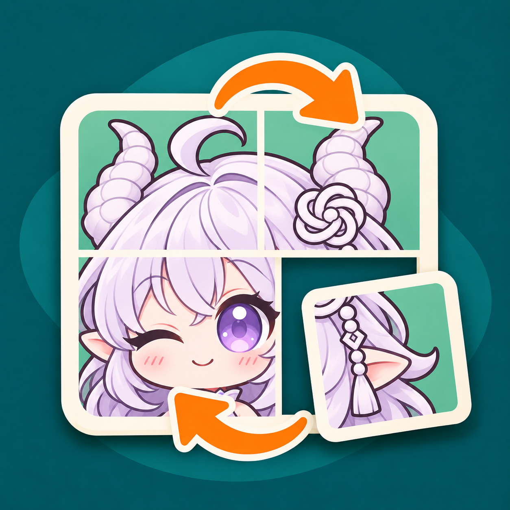
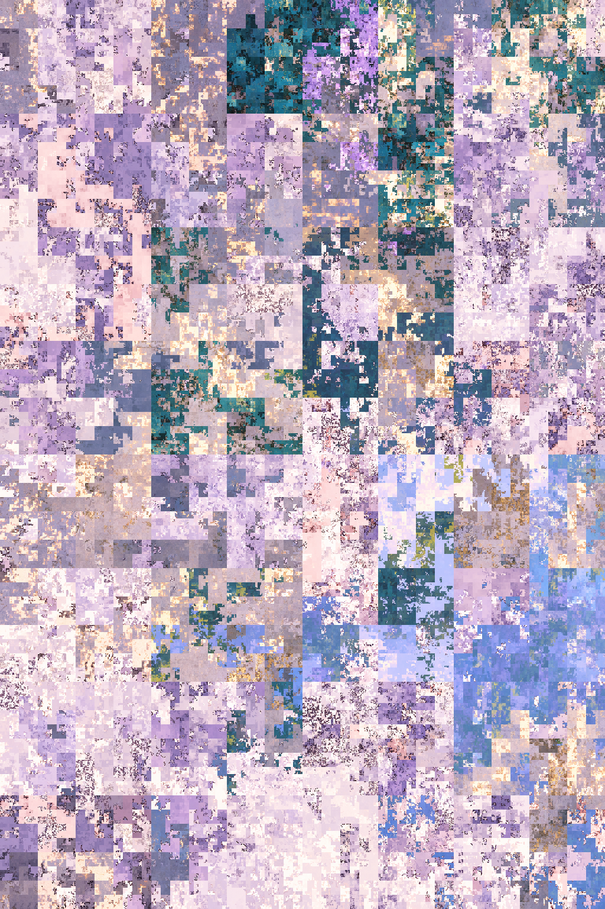

# 图片混淆/解混淆插件

在 QQ 聊天里把一张图打乱，再按相同次数还原。兼容小番茄图片混淆的默认算法，适合图片解谜和群聊互动。处理在 AstrBot 所在机器完成，不用配置模型或 API Key。

> 这是可逆的像素置乱，不是加密。不要用它隐藏敏感信息。

## 快速上手

1. 在同一条消息中附图并发送 `/混淆2`，也可以回复目标图片后发送这条指令。
2. 回复机器人返回的混淆图，发送 `/解混淆2`。两次指令末尾的数字要相同。

| 原图：非 Q 版 GPT 白龙娘 | `/混淆2`：实际输出 | `/解混淆2`：实际还原 |
| --- | --- | --- |
|  |  |  |

三张图均为 1024×1536。中图由插件混淆两次得到，右图再用中图解混淆两次得到；逐像素比较确认右图与原图一致。[下载混淆 PNG](docs/demo-scrambled-x2.png)可直接试 `/解混淆2`。

不写数字时默认 1 次，即 `/混淆` 和 `/解混淆`；可以指定 1–50 次。一条消息有多张图片时，只处理第一张。群里没有响应时，按当前 AstrBot 的唤醒设置 @机器人或使用唤醒词。

### 为什么还原后还是乱的？

确认回复的是**混淆结果图**，并使用原来的次数。保留原始混淆 PNG，不要截图、裁剪、缩放或有损压缩；如果 QQ 转发改变了图片像素，即使尺寸一样，也无法精确还原。

## 和小番茄互解

本插件兼容使用同一套 Gilbert 曲线与黄金比例偏移的[小番茄图片混淆网页版](https://iris10086.github.io/pic-scramble/)默认算法。已和[该网页的实现](https://github.com/iris10086/pic-scramble/blob/master/index.html)在 JPEG 编码前做过双向像素验证，无需安装另一个 AstrBot 插件。

- **小番茄 → QQ**：网页混淆一次的图，在 QQ 带图或回复后发送 `/解混淆`；如果混淆了两次，用 `/解混淆2`。
- **QQ → 小番茄**：把插件返回的混淆 PNG 原样导入网页，按原次数点击「解混淆」。「还原」只会恢复刚导入的图片，不是解混淆。

互解要保持图片尺寸和次数一致。网页导出的 JPEG 可能损失部分细节，推荐在传递时保留 PNG 原图；使用额外密钥或不同重排规则的变体不在上述兼容范围内。

## 安装

要求 AstrBot 4.0.0 或更新版本、Python 3.11 或更新版本，以及 QQ 的 `aiocqhttp` 适配器（可搭配 NapCat）。

在 AstrBot 插件市场搜索「图片混淆/解混淆插件」，或从[本仓库](https://github.com/aaron6769/astrbot_plugin_image_confusion)安装。手动安装时，将仓库放在 `data/plugins/astrbot_plugin_image_confusion`，进入该目录，在 AstrBot 使用的 Python 环境里执行 `pip install -r requirements.txt`，然后重载插件。

## 输出与保留时间

- 输出静态 PNG，保存于插件数据目录的 `outputs` 文件夹。
- 在插件配置的「输出清理 → 输出图片保留小时数」中可修改保留时间，默认 24 小时。过期输出在插件启动或下次处理图片前清理；填 `0` 不按时间清理。
- 单个输入文件最多 25 MiB，解码后最多 1200 万像素。超限时会拒绝处理，避免为超大图片分配像素路径和输出缓冲区。

## 算法简述

插件按图片尺寸生成 Gilbert Curve 路径，把 RGBA 像素沿路径移动。混淆和解混淆的偏移方向相反；混淆图的尺寸与像素保持不变时，使用相同次数就能还原插件收到的原图像素。

## 许可与素材

插件代码采用 [MIT 许可证](LICENSE)。白龙娘图标和演示原图为 AI 辅助同人创作，原角色设计署名 ZipZipPipe；使用条件见[素材说明](ARTWORK_NOTICE.md)。
